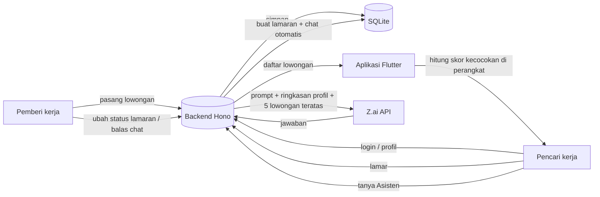

# Kerjaqueue

Jaringan kerja harian untuk UMKM lokal. Pencari kerja membangun profil profesional,
menemukan pekerjaan yang sesuai, mengirim lamaran, lalu berkomunikasi langsung
dengan pemberi kerja lewat pesan dalam aplikasi.

> Logicodix 2026 — HIMTI UNESA · Subtema: Local MSME & Creative Economy

| | |
| --- | --- |
| Nama tim | Pejuang Mamah |
| Kategori | **Mobile** (Android) |
| Nama aplikasi | Kerjaqueue |
| Subtema | Local MSME & Creative Economy |

## Tim

| Nama | Peran |
| --- | --- |
| Marvello Faisal | Ketua Tim · Lead Developer |
| Arya Mada Hastasurya | Mobile App Developer |
| Rafli Akhdan Fareza | Copywriter |
| Zulfan Maulana Ahmad | UI/UX Designer |

## Masalah

UMKM lokal (warung kopi, bengkel, konveksi, laundry, katering) sering butuh tenaga
tambahan mendadak untuk satu shift, satu hari, atau satu pekerjaan borongan. Selama ini
pencarian biasanya lewat kenalan atau grup WhatsApp: lambat, tidak terdata, dan pemilik
usaha sulit menilai apakah calon pekerja punya keahlian dan jadwal yang cocok.
Di sisi lain, pencari kerja harian tidak punya satu tempat untuk melihat pekerjaan di
sekitarnya yang sesuai keahlian, jarak, upah minimum, dan jam luangnya.

## Solusi

Kerjaqueue mendigitalkan proses rekrutmen harian UMKM: pemilik usaha memasang
lowongan dengan tingkat urgensi (hari ini / minggu ini / fleksibel), pencari kerja
melihat feed yang diurutkan berdasarkan urgensi dan **skor kecocokan yang menjelaskan
alasannya**, melamar dengan satu ketukan, lalu langsung berbicara dengan pemilik usaha
lewat chat dalam aplikasi. Asisten AI membantu pencari kerja memilih lowongan.

## Target pengguna

- **Pemberi kerja:** pemilik UMKM lokal yang butuh pekerja harian atau borongan.
- **Pencari kerja:** pekerja harian, pelajar/mahasiswa yang mencari kerja paruh waktu,
  dan warga sekitar yang ingin penghasilan tambahan.

## Fitur yang sudah berjalan

- Daftar dan masuk dengan email + kata sandi; Google Sign-In (perlu konfigurasi OAuth).
- Onboarding profil: nama, headline, kecamatan, keahlian, pengalaman, upah minimum,
  jam kerja, dan jarak maksimal.
- Beranda pencari kerja: lowongan diurutkan berdasarkan urgensi dan skor kecocokan
  0–100 (keahlian, jarak, upah, jadwal) beserta alasan dan kekurangannya.
- Pencarian lowongan dan profil orang; halaman profil publik.
- Pemberi kerja: pasang lowongan, tandai terisi, hapus, lihat daftar pelamar beserta
  kontaknya, dan ubah status lamaran (dilihat → wawancara → diterima/ditolak).
- Pencari kerja: daftar lamaran beserta statusnya dan tarik lamaran.
- Chat privat pekerja–pemberi kerja yang dibuat otomatis saat melamar, dengan
  penanda pesan belum dibaca.
- Asisten AI (Z.ai) dengan jawaban lokal berbasis skor kecocokan saat API tidak tersedia.

## Teknologi

| Bagian | Teknologi |
| --- | --- |
| Aplikasi mobile | Flutter (Dart), `http`, `flutter_secure_storage`, `google_sign_in` |
| Backend | Node.js 24, Hono, `@hono/node-server`, `zod` (validasi), `jose` (JWT) |
| Database | SQLite melalui modul bawaan `node:sqlite` |
| Layanan pihak ketiga | Z.ai Chat Completions API (`glm-4.7-flash`), Google OAuth 2.0 / JWKS |

## Arah produk

Kerjaqueue mengadaptasi pola jaringan profesional: profil beridentitas, feed yang
bisa dicari, lamaran berstatus, profil publik, dan percakapan pekerja–pemberi kerja.
Fokusnya tetap kebutuhan UMKM lokal yang perlu pekerja hari ini, bukan menyalin
seluruh fitur LinkedIn.

| Area | Isi |
| --- | --- |
| Identitas | Akun wajib: email + kata sandi atau Google Sign-In |
| Profil | Nama lengkap, nama panggilan, headline, kecamatan, keahlian, pengalaman |
| Beranda | Feed urgensi + skor kecocokan yang menjelaskan alasan |
| Cari | Lowongan dan profil orang; pencarian kata kunci |
| Lamaran | Status terkirim/dilihat/diwawancara/diterima/ditolak |
| Chat | Percakapan privat otomatis dibuat saat melamar |
| Asisten | Z.ai melalui backend; jawaban lokal saat API tidak tersedia |

First run menampilkan landing page dengan pilihan “Buat akun gratis”, “Masuk”,
dan Google sebelum form autentikasi. Jika OAuth Google belum dikonfigurasi, tombol
Google menampilkan alasan dan mengarahkan pengguna ke form email; itu bukan login
Google yang berhasil.

## Arsitektur

```
Flutter app ── HTTPS/JSON + Bearer JWT ──► backend (Hono + Node 24)
                                            ├── SQLite (akun, lowongan, lamaran, chat)
                                            ├── Google JWKS (verifikasi ID token)
                                            └── Z.ai API (Asisten; key hanya di server)
```

Skor kecocokan tetap dihitung di `lib/domain/match.dart`, jadi algoritme tunggal
untuk aplikasi dan bisa diuji tanpa emulator. API mengirim data lowongan mentah.

### Alur data utama



## Menjalankan

Terminal 1 — API:

```bash
cd backend
cp .env.example .env
npm install
npm start
```

Node 24+ diperlukan untuk TypeScript native dan `node:sqlite`. API default di
`http://localhost:8080`; healthcheck: `GET /health`. Pada Windows, gunakan
salinan `.env.example` sebagai `.env` lalu ubah `JWT_SECRET` dan `DEMO_PASSWORD`.

Terminal 2 — Flutter:

```bash
flutter pub get
flutter run --dart-define=API_BASE_URL=http://10.0.2.2:8080
```

`10.0.2.2` adalah alamat host dari Android Emulator. Untuk perangkat Android fisik,
gunakan IP LAN komputer pengembang. Release publik wajib menggunakan HTTPS.

### Akses untuk juri

| | |
| --- | --- |
| APK Android | ⚠️ ISI tautan unduhan APK |
| Backend API | ⚠️ ISI `https://...` (healthcheck: `/health`) |

### Akun demonstrasi

Saat database baru masih kosong, backend mengisi lowongan contoh dan dua akun demo:

| Email | Kata sandi | Peran |
| --- | --- | --- |
| `pencari@kerjaqueue.local` | ⚠️ ISI | pencari kerja |
| `pemberi@kerjaqueue.local` | ⚠️ ISI | pemberi kerja |

Kata sandi kedua akun diambil dari `DEMO_PASSWORD` di server. Untuk server penilaian,
biarkan `SEED=true` dan pakai `DEMO_PASSWORD` baru yang hanya dipakai untuk akun demo
ini. Setelah penilaian selesai, matikan `SEED` dan hapus akun demo.

### Google Sign-In

1. Buat OAuth 2.0 Client ID tipe **Web application** di Google Cloud.
2. Set `GOOGLE_CLIENT_ID` di backend dan `GOOGLE_SERVER_CLIENT_ID` di build Flutter
dengan Web Client ID yang sama.
3. Daftarkan package `com.logicodix.pejuangmamah` dan SHA-1 debug/release di Google
Cloud. Untuk iOS, siapkan bundle ID, URL scheme `REVERSED_CLIENT_ID`, dan uji alur
platform secara terpisah.
4. Build/run:

```bash
flutter run \
  --dart-define=API_BASE_URL=https://api.example.com \
  --dart-define=GOOGLE_SERVER_CLIENT_ID=<web-oauth-client-id>
```

Backend memverifikasi signature, issuer, audience, expiry, dan `email_verified`
Google ID token sebelum menukar token itu menjadi sesi Kerjaqueue. Sampai kredensial
Google didaftarkan, email + kata sandi tetap tersedia.

### Asisten Z.ai

1. Cabut/rotasi key Z.ai yang pernah ditempel di chat. Key itu dianggap bocor dan
tidak aman digunakan kembali.
2. Isi key baru sebagai environment variable/secret di server: `ZAI_API_KEY`.
3. Pastikan model `glm-4.7-flash` aktif di akun Z.ai. Model default dapat diganti
dengan `ZAI_MODEL` tanpa build ulang aplikasi.

API mengirim prompt, riwayat percakapan, ringkasan profil, dan lowongan teratas ke
Z.ai. Foto, email, dan nomor telepon tidak ikut pada payload Asisten. Batas pemakaian
harian dan rate limit diterapkan di backend; gunakan reverse proxy TLS dan observasi
biaya provider saat deploy.

## Keamanan dan privasi

- Kata sandi di-hash scrypt dengan salt unik; sesi berupa JWT HS256 berumur 30 hari.
- Jangan commit `.env`, `JWT_SECRET`, `ZAI_API_KEY`, atau kredensial OAuth.
- Google dan email memakai sesi backend yang sama; tidak ada mode tamu.
- Token sesi disimpan dengan `flutter_secure_storage` di Android Keystore/iOS Keychain;
  semua profil, lamaran, lowongan, dan pesan tetap di backend.
- Profil publik tidak mengembalikan email atau telepon. Backend hanya menyertakan
  kontak pelamar kepada pemilik lowongan.
- SQLite ditujukan untuk satu instans backend dengan volume persisten. Untuk beberapa
  instans, migrasikan implementasi `backend/src/db/` ke PostgreSQL.
- Set `APP_ORIGINS` ke origin yang benar dan tempatkan API di belakang TLS reverse
  proxy sebelum membuka ke internet.

## Pengujian

```bash
cd backend
npm test
```

```bash
flutter analyze
flutter test
```

Tes mencakup API auth/profil/lowongan/lamaran/chat, otorisasi lintas pengguna,
validasi payload, model dan skor match, pemetaan HTTP Flutter, dan alur widget login,
onboarding, feed, lamar, chat, asisten lokal, profil, serta sign-out.

## Yang belum siap untuk rilis publik

- Produksi butuh deployment server persisten, HTTPS, secret manager, backup/restore
  SQLite, monitoring, dan rencana migrasi database.
- Sediakan kebijakan privasi/retensi dan proses penghapusan akun serta data sebelum
  rilis publik; itu belum disediakan di MVP ini.
- Google OAuth, Z.ai live endpoint, iOS, accessibility audit pada perangkat nyata,
  dan pengetesan beban belum terverifikasi tanpa kredensial/deployment.
- Belum ada push notification, moderation/reporting, verifikasi usaha/identitas,
  upload avatar, atau perlindungan spam lanjutan.

## Penggunaan AI

**Di dalam produk**

| Layanan / model | Bagian produk | Data yang dikirim |
| --- | --- | --- |
| Z.ai Chat Completions, model `glm-4.7-flash` | Tab Asisten: menjawab pertanyaan pencari kerja tentang lowongan yang cocok | Pertanyaan, riwayat percakapan, nama, keahlian, kecamatan, upah minimum, dan 5 lowongan teratas. Email, nomor telepon, dan foto tidak dikirim. |

Panggilan ke Z.ai hanya dilakukan oleh backend; API key tidak ada di aplikasi. Jika
Z.ai tidak tersedia atau kuota harian habis, aplikasi memberi jawaban lokal yang
dihitung dari skor kecocokan di `lib/application/ask_assistant.dart`.

**Dalam proses pengembangan**

- Claude (Anthropic) melalui Claude Code dipakai untuk review kode, perbaikan izin
  `INTERNET` Android dan dashboard pemberi kerja, serta penyusunan README ini.
- ⚠️ ISI alat AI lain yang dipakai tim (nama alat dan bagian yang dibantu), atau hapus
  baris ini jika tidak ada.

Seluruh kode hasil bantuan AI ditinjau dan menjadi tanggung jawab tim.

## Kredit dan atribusi

| Komponen | Sumber | Lisensi |
| --- | --- | --- |
| Flutter, Material Icons | Google | BSD-3-Clause / Apache 2.0 |
| `http`, `flutter_secure_storage`, `google_sign_in` | pub.dev | BSD-3-Clause |
| Hono, `@hono/node-server` | honojs | MIT |
| `zod` | colinhacks | MIT |
| `jose` | panva | MIT |
| Z.ai API | Z.ai | Ketentuan layanan Z.ai |
| Google Sign-In / OAuth 2.0 | Google | Ketentuan layanan Google |
| Font | bawaan Flutter | — |
| Data lowongan contoh | dibuat tim (fiktif) | — |

## Lisensi

Proyek lomba, tidak dipublikasikan ke pub.dev.
